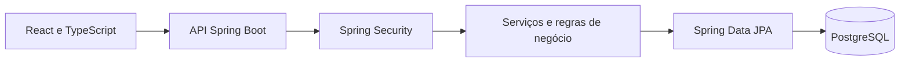
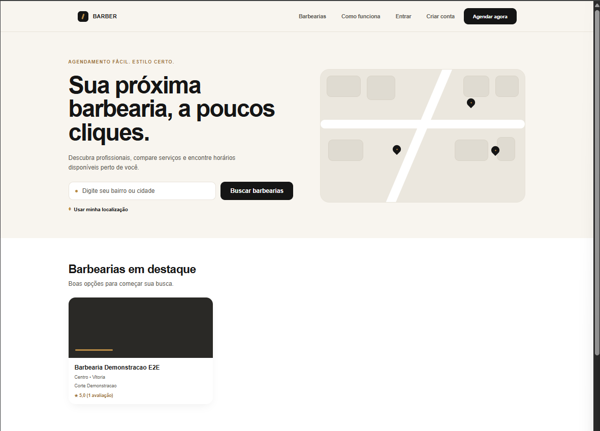
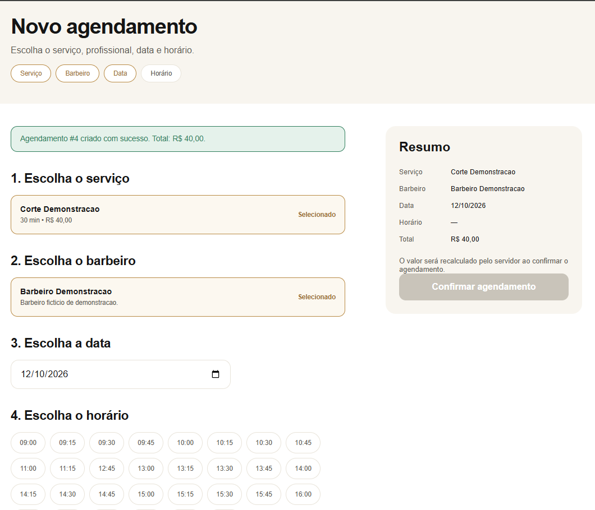
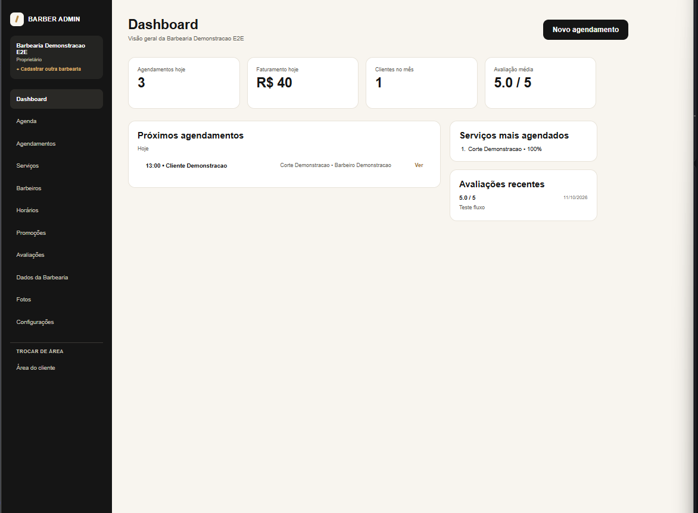
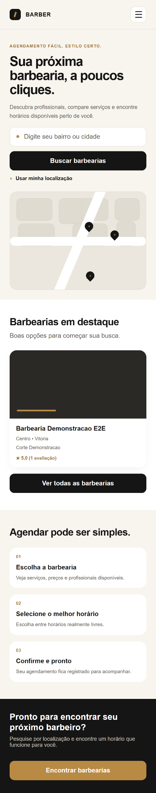
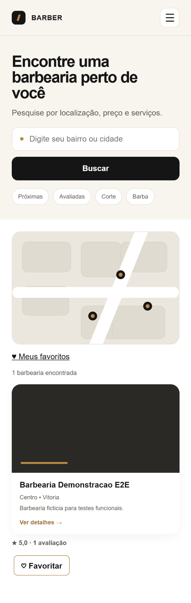
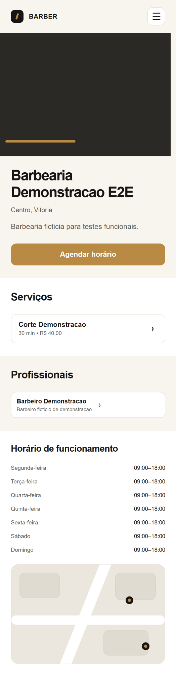
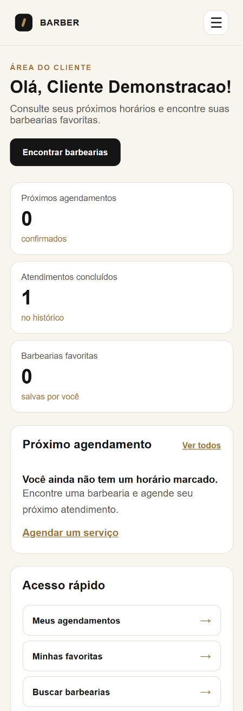
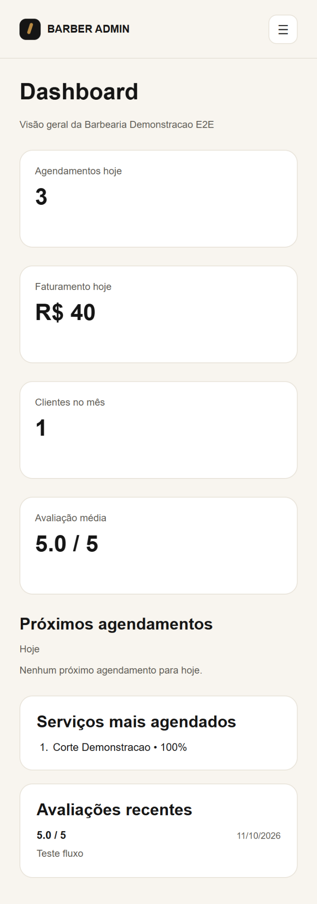
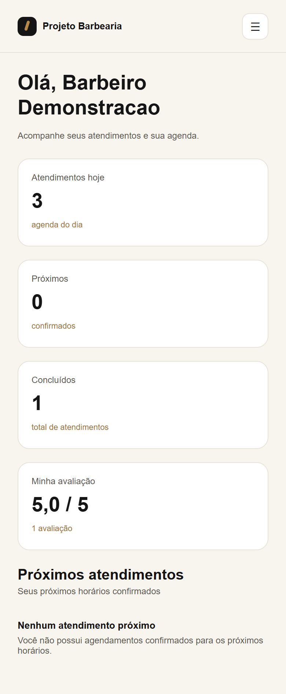

# Projeto Barbearia

Plataforma web full-stack para encontrar barbearias, consultar serviços e realizar agendamentos online.

Projeto acadêmico desenvolvido com **Java, Spring Boot, React, TypeScript e PostgreSQL**. A aplicação possui interfaces para **clientes**, **proprietários** e **barbeiros**, com autenticação, controle de acesso e regras de agendamento executadas no servidor.

## Tecnologias

| Camada | Ferramentas |
| --- | --- |
| Backend | Java 25, Spring Boot 4.1.1, Spring Web MVC |
| Segurança | Spring Security, autenticação por sessão, proteção CSRF |
| Persistência | Spring Data JPA, Hibernate |
| Banco de dados | PostgreSQL |
| Frontend | React 19, TypeScript, Vite 8, React Router, Axios e CSS |
| Testes | JUnit 5, Mockito, Spring Boot Test, MockMvc e PostgreSQL |
| Versionamento | Git e GitHub |

## Funcionalidades

### Clientes

- Cadastro, login e gerenciamento da sessão.
- Pesquisa textual de barbearias por localização e filtros de serviços e avaliações.
- Consulta de barbearias, profissionais, serviços, horários, preços e fotos.
- Agendamento e cancelamento de atendimentos.
- Acompanhamento de próximos atendimentos e histórico.
- Avaliação de serviços concluídos.
- Lista de barbearias favoritas e consulta de promoções aplicáveis.
- Página inicial com até três barbearias ativas cadastradas, usando endereço, serviços e avaliações reais da API; sem avaliações fictícias.

### Proprietários

- Painel administrativo e visualização da agenda.
- Gerenciamento de barbearias, serviços, barbeiros e horários de funcionamento.
- Consulta e gerenciamento de agendamentos.
- Cadastro de promoções e gerenciamento da galeria de fotos.
- Consulta de avaliações e configurações da barbearia.
- Cadastro de múltiplas unidades e seleção da barbearia administrada, com dados separados e seleção mantida após atualização da página.

### Barbeiros

- Painel próprio, agenda e histórico de atendimentos.
- Consulta de serviços vinculados e avaliações.
- Configuração da disponibilidade.
- Conclusão de atendimentos e registro de não comparecimento, quando permitidos.
- Acesso exclusivo à área profissional para barbeiros funcionários; proprietários também cadastrados como barbeiros mantêm os três perfis.

## Arquitetura

O frontend React consome uma API REST Java. As regras de negócio são verificadas no backend, que utiliza Spring Data JPA para persistir os dados no PostgreSQL.



Durante o desenvolvimento, o Vite utiliza um proxy para encaminhar as chamadas `/api` ao Spring Boot.

## Regras de negócio principais

- Um proprietário pode administrar várias barbearias e escolher a unidade atual no painel; um barbeiro está vinculado a uma barbearia.
- Cada serviço possui preço e duração, e cada barbeiro só pode realizar serviços aos quais está vinculado.
- Agendamentos respeitam o funcionamento da barbearia e a disponibilidade do profissional.
- Existe um intervalo obrigatório de **15 minutos** entre atendimentos.
- O backend utiliza transações e bloqueio pessimista durante a reserva para evitar conflitos entre solicitações simultâneas.
- Agendamentos não podem ser criados no passado; seus valores são calculados pelo servidor.
- Promoções válidas podem aplicar descontos aos serviços elegíveis.
- O cancelamento de um agendamento confirmado só é permitido antes do horário de início.
- Um atendimento só pode ser concluído após seu término previsto; a ausência só pode ser registrada após a tolerância de 15 minutos contada do horário de início.
- Avaliações dependem de um agendamento concluído, com autorização do cliente correspondente.
- A ativação de uma barbearia exige proprietário ativo, endereço, funcionamento, barbeiro ativo e serviço ativo.
- A autorização de operações depende do usuário autenticado e de seus vínculos com os recursos.
- O barbeiro funcionário, sem perfil de cliente, não pode realizar operações de cliente pela API (criação de agendamentos, favoritos e avaliações). Um proprietário também vinculado como barbeiro conserva seus três perfis.

### Status de agendamento

| Status | Significado |
| --- | --- |
| `CONFIRMADO` | Reserva registrada |
| `CONCLUIDO` | Atendimento finalizado |
| `CANCELADO` | Reserva cancelada |
| `NAO_COMPARECEU` | Cliente não compareceu |

## Estrutura do repositório

```text
projeto-barbearia/
├── backend/       # API Java e Spring Boot
├── frontend/      # Aplicação React e TypeScript
├── database/      # Scripts SQL e migrações
├── docs/          # Documentação
└── README.md
```

## Pré-requisitos

- JDK 25 e Maven.
- Node.js e npm compatíveis com Vite 8.
- PostgreSQL, com os bancos e tabelas previamente preparados.
- Git.

## Configuração do banco

O banco principal é `projeto_barbearia`. Os scripts SQL e as migrações estão em `database/` e `database/migrations/`.

O backend espera um usuário PostgreSQL chamado `barbearia_app` e lê a senha pela variável de ambiente `DB_PASSWORD`. Essa variável precisa estar configurada em cada terminal que executar o backend ou testes que dependam do banco.

A opção `spring.jpa.hibernate.ddl-auto=validate` **valida a estrutura existente**; ela não cria automaticamente as tabelas. É necessário preparar a estrutura antes de iniciar a aplicação.

**Não armazene senhas reais nem credenciais de demonstração no Git.**

## Executar localmente

Os exemplos abaixo são para PowerShell no Windows, a partir da raiz do repositório.

### Backend principal

Configure `DB_PASSWORD` no terminal e execute:

```powershell
cd backend
mvn spring-boot:run
```

API: <http://localhost:8080>

### Frontend principal

Abra outro terminal na raiz do repositório:

```powershell
cd frontend
npm ci
npm run dev
```

Interface: <http://localhost:5173>

O frontend encaminha `/api` para `http://localhost:8080` por padrão.

## Ambiente isolado para testes funcionais

Os testes que criam ou modificam registros devem utilizar um banco separado: `projeto_barbearia_teste`. Esse banco precisa existir e conter a mesma estrutura de tabelas e migrações. Não utilize registros reais para esses testes.

### Backend isolado — porta 8081

Em um novo terminal, com `DB_PASSWORD` configurada:

```powershell
cd backend
$env:SERVER_PORT = "8081"
$env:SPRING_DATASOURCE_URL = "jdbc:postgresql://localhost:5432/projeto_barbearia_teste"
mvn spring-boot:run
```

### Frontend isolado — porta 5174

Em outro terminal:

```powershell
cd frontend
$env:BARBEARIA_API_TARGET = "http://localhost:8081"
npm run dev -- --host 127.0.0.1 --port 5174 --strictPort
```

Interface isolada: <http://127.0.0.1:5174>

As variáveis de ambiente acima são locais aos respectivos terminais. Para preservar a separação das sessões no navegador, utilize `127.0.0.1:5174` para testes e `localhost:5173` para o ambiente principal.

## Testes automatizados

### Suíte Java regular

Na pasta `backend`, com `DB_PASSWORD` configurada e PostgreSQL disponível:

```powershell
$env:SPRING_DATASOURCE_URL = "jdbc:postgresql://localhost:5432/projeto_barbearia_teste"
mvn test
```

**Última execução confirmada: 70 testes aprovados, 0 falhas (12/10/2026, banco `projeto_barbearia_teste`).** A suíte cobre, entre outros pontos, autorização, segurança de rotas HTTP, conflitos de horários, regras temporais, permissões de funcionários, favoritos e preços promocionais. As alterações posteriores na Home e na seleção de múltiplas unidades foram verificadas com lint, build e testes manuais; não foram adicionados testes automatizados de frontend.

### Teste de concorrência no PostgreSQL

O teste `AgendamentoConcorrenciaIT` exercita duas tentativas simultâneas de reservar o mesmo profissional e horário. Ele utiliza explicitamente `projeto_barbearia_teste` e verifica que apenas uma tentativa seja confirmada.

Na pasta `backend`, com o banco isolado preparado:

```powershell
mvn "-Dtest=AgendamentoConcorrenciaIT" test
```

Esse teste de integração foi aprovado em execução separada e **não integra a contagem dos 70 testes da suíte regular**.

### Frontend

Na pasta `frontend`:

```powershell
npm run lint
npm run build
```

Os dois comandos foram aprovados na última validação.

## Testes funcionais realizados

Os fluxos principais foram verificados manualmente no navegador com contas fictícias e banco isolado:

1. Cliente cria um agendamento.
2. Proprietário e barbeiro visualizam a mesma reserva.
3. Barbeiro conclui um atendimento.
4. Cliente acompanha o histórico e registra uma avaliação.
5. Cliente cancela outra reserva.
6. Barbeiro registra um não comparecimento.
7. A conclusão e as notas da avaliação são verificadas diretamente no PostgreSQL.
8. Agendamentos futuros deixam de exibir ações antecipadas de conclusão e ausência.
9. Funcionário barbeiro acessa apenas sua área profissional e é redirecionado ao tentar acessar o cadastro de barbearia.
10. Proprietário que também é barbeiro alterna entre as três áreas na mesma sessão.
11. Proprietário cadastra uma segunda unidade, alterna entre estabelecimentos sem misturar dados de serviços e agendamentos, e mantém a seleção após atualizar a página.
12. A página inicial destaca barbearias ativas com informações e avaliações fornecidas pela API; unidades inativas não aparecem.

As telas das áreas pública, de cliente, de proprietário e de barbeiro também foram verificadas visualmente. A revisão mobile incluiu Home, listagem, detalhes e os três dashboards, em largura de 390 px, incluindo captura de página completa. Os quatro status de agendamento foram exercitados nos testes. Essas verificações não representam cobertura exaustiva de todos os cenários possíveis.

Após a correção da autorização, o endpoint de leitura `/api/favoritos` negou a consulta à conta de funcionário barbeiro e retornou uma lista vazia para a conta de proprietário que também possui perfil de cliente. Os códigos HTTP exatos não foram registrados nas capturas compartilhadas; os testes automatizados de autorização também foram aprovados.

## Segurança

A aplicação emprega autenticação por sessão, proteção CSRF, rotas protegidas e validações de autorização no backend. As permissões consideram o usuário autenticado e os recursos aos quais ele está vinculado.

Os testes realizados não substituem uma auditoria de segurança completa para disponibilização pública.

## Fotografias

Arquivos de imagem locais ficam em `frontend/public/imagens`. O proprietário pode organizar registros de fotos por URL, ativação e ordem. Fotografias públicas ativas são utilizadas nas listagens, nos detalhes das barbearias e nos favoritos.

## Capturas do sistema

Telas reais da aplicação local, utilizando **contas e dados fictícios** no ambiente isolado de testes. Clique nas imagens para ampliá-las. As capturas registram o estado da aplicação durante os testes de outubro de 2026; os registros exibidos podem mudar.

| Página inicial e destaques da API | Agendamento de serviço |
| --- | --- |
| <a href="docs/imagens/screenshots/home-desktop.png"></a> | <a href="docs/imagens/screenshots/agendamento-desktop.png"></a> |

| Painel administrativo do proprietário |
| --- |
| <a href="docs/imagens/screenshots/proprietario-desktop.png"></a> |

<details>
<summary><strong>Ver capturas da versão para celular</strong></summary>

| Início | Busca | Detalhes |
| --- | --- | --- |
| <a href="docs/imagens/screenshots/home-mobile.png"></a> | <a href="docs/imagens/screenshots/busca-mobile.png"></a> | <a href="docs/imagens/screenshots/detalhes-mobile.png"></a> |

| Cliente | Proprietário | Barbeiro |
| --- | --- | --- |
| <a href="docs/imagens/screenshots/cliente-mobile.png"></a> | <a href="docs/imagens/screenshots/proprietario-mobile.png"></a> | <a href="docs/imagens/screenshots/barbeiro-mobile.png"></a> |

</details>

As imagens foram selecionadas para não incluir senhas, tokens ou e-mails das contas fictícias. A captura da área do cliente foi limitada à parte superior para ocultar os dados da conta. Nenhum dado foi alterado no PostgreSQL para gerar esta galeria.
## Documentação de apresentação e validação

- [Roteiro de apresentação](docs/roteiro-apresentacao.md): sequência sugerida para demonstrar o projeto.
- [Checklist de validação final](docs/checklist-validacao-final.md): evidências existentes e verificações pendentes para a entrega.
- [Fluxo Git](docs/fluxo-git.md): organização das branches e colaboração.

## Estado do projeto

Os principais fluxos estão implementados e foram validados localmente. A aplicação está funcional para demonstração acadêmica e apresentação em portfólio. A revisão mobile de seis áreas e a suíte Java de 70 testes foram concluídas. A ativação completa de uma segunda unidade, um agendamento nela e o isolamento de reservas entre unidades também foram verificados no banco de testes. A tela de login foi conferida em celular, inclusive com Tab, Shift+Tab e senha incorreta (401). Permanecem verificações complementares no checklist, como cenários adicionais de erro, navegação por teclado em outros formulários e reprodução a partir de um clone limpo.

Antes de uma implantação pública, ainda são recomendados testes mais amplos de segurança e carga, revisão de casos extremos, configuração de hospedagem, monitoramento e backups.

## Repositório

<https://github.com/Christopher-SNC/projeto-barbearia>
